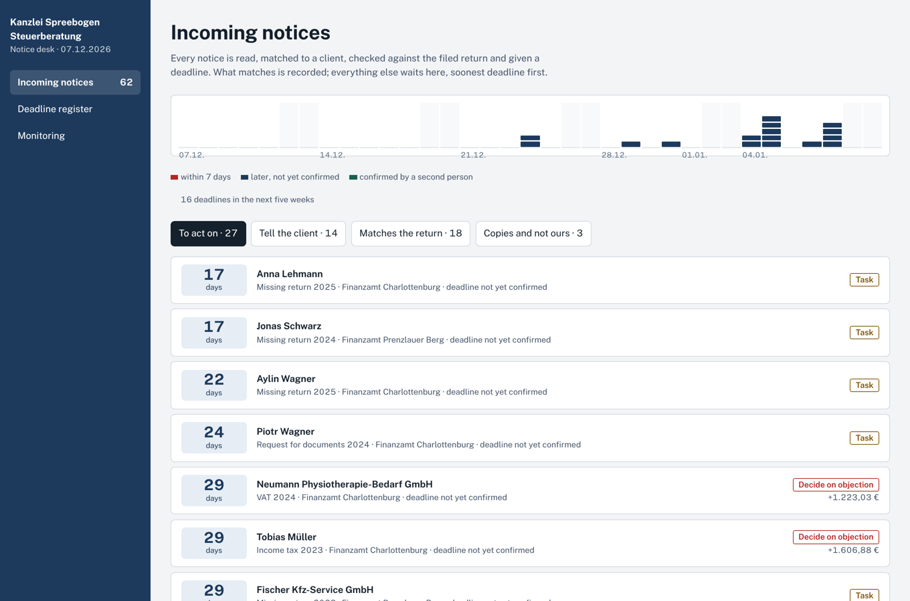
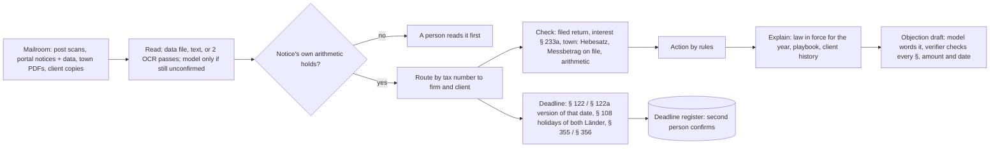
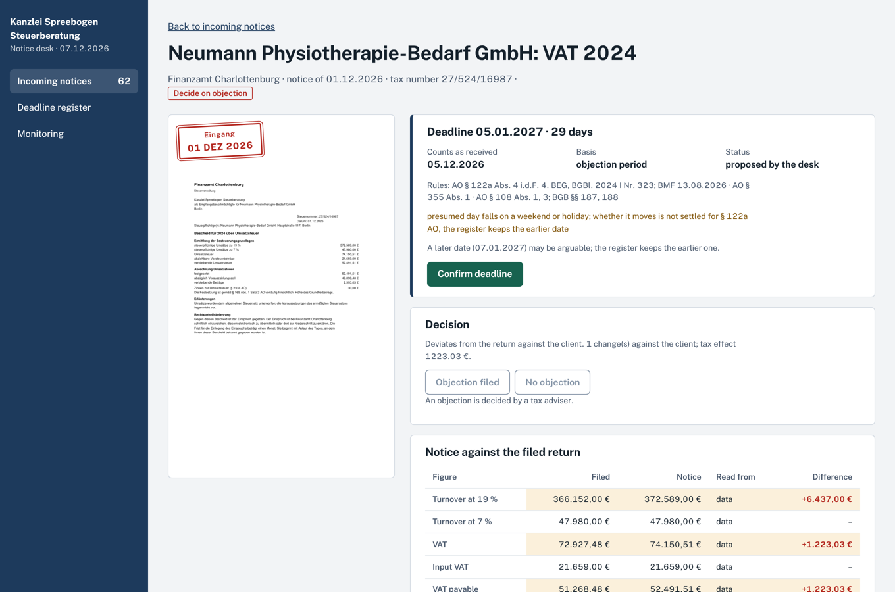
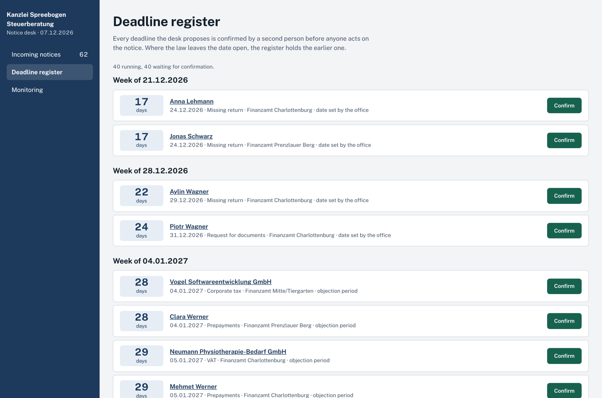
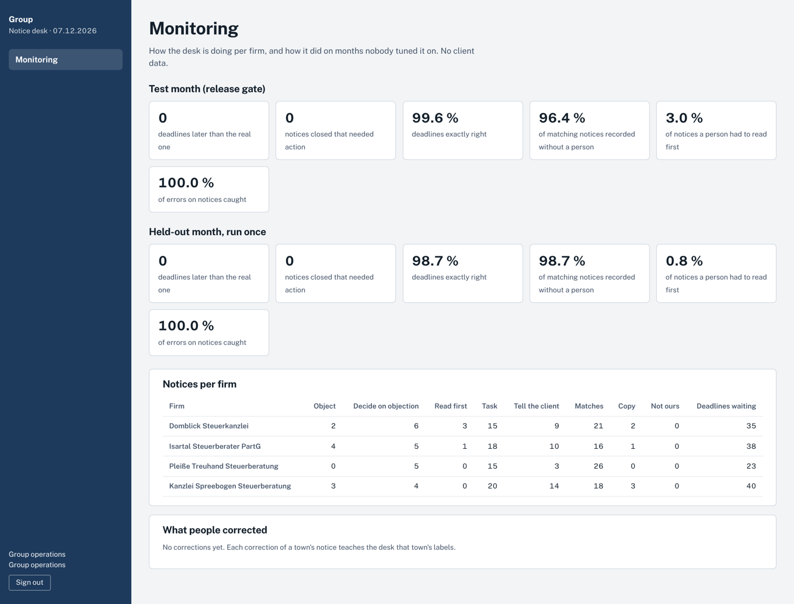

# tax-notice-desk

AI document intelligence and agents for the **tax notices** that reach a group of German tax firms. Notices
come from the tax office (Finanzamt), from towns and from clients. The desk reads every notice, whether it is
an electronic notice with its data file, a scanned letter, or a town's own layout.

For each notice it:

- matches the notice to the right firm and client;
- computes the objection deadline under the rules of that date;
- checks the notice against the return the firm filed;
- recomputes the town's trade tax and the interest;
- explains every difference with the paragraph of law in force for that tax year, the firm's playbook and
  the client's history.

Then it decides what happens next. Notices that match are recorded with nobody needing to look. A deadline goes
into a register only once a second person confirms it. An objection is drafted for the adviser to release.



## Why notices

A Bescheid starts a one-month clock, and a missed objection deadline is the classic liability case for a tax
adviser. Three changes make this harder now:

- **Bekanntgabe moved twice.** A posted notice counts as received on the fourth day since 2025 (PostModG). A
  notice made available for download counts from the day it was made available since 2026 (4. BEG).
- **Digital by default from 2027.** Electronic notices become the standard in 2027 (§ 122a AO), so firms receive
  them in bulk.
- **Towns still send paper.** Trade-tax notices (Gewerbesteuerbescheide) from about 11,000 towns still arrive
  largely on paper, in roughly 600 formats.

Commercial tools check notices that come with data. The desk also handles the paper. It treats the deadline as
the one number that may never be late, and every value it trusts must be confirmed by the notice's own
arithmetic.

## Results

Measured end to end on a synthetic group: 4 firms, 96 clients, about 235 notices a month, 45 % of them scans.
The answer key is computed independently of the desk. See [docs/EVALUATION.md](docs/EVALUATION.md) for the
splits and for **what has been studied**.

| | Test month: release gate (studied after its first run) | Held-out month (run once, not studied) |
|---|---|---|
| Notices | 230 (59 % scans) | 237 (mostly electronic, as from 2027) |
| Deadlines later than the real one | **0** | **0** |
| Notices closed that needed action | **0** | **0** |
| Values trusted that were wrong | **0** | **0** |
| Deadlines exactly right (the rest are earlier, by design) | 99.6 % | 98.7 % |
| Right action (close, tell client, object, task, …) | 97.0 % | 98.3 % |
| Matching notices recorded without a person | 96.4 % | 98.7 % |
| Notices a person must read first | 3.0 % | 0.8 % |
| Errors on notices caught (wrong Hebesatz, outdated Messbetrag, arithmetic, interest) | 100 %, no false alarms | 100 %, no false alarms |
| Right paragraph of law in the top 3 | 100 % | 96.4 % |
| Model cost for reading | $0.011 (14 scans) | $0.022 (29 scans) |

On the test month's first run the release gate **refused to ship**: the model had read a refund's interest
with the wrong sign, and the desk trusted it. The interest-sign rule that fixed it is in
[EVALUATION.md](docs/EVALUATION.md).

With the model switched off, the same month needs a person for 7.0 % of notices instead of 3.0 %. Trusted wrong
values stay at 0 and late deadlines stay at 0: the model only takes work off people, it never decides.

**Blind case sets.** Notices written by an author who saw only [the contract](docs/NOTICE_RULES.md) and
[the writing guide](heldout/WRITING_CASES.md), never the code:

- **blind-1, first run: 7 of 55 right, and 2 deadlines too late.** The desk had been fitted to its own
  simulator's layouts. Real offices print the taxes side by side in a column table, towns write sentences,
  pipes, `EUR 1 234,56` or `42.740 €`, and the label reader found too few values. Every such notice went to a
  person (safe), but two paper notices without instructions on how to object got the one-year period, because
  the desk only assumed one month for scans, not for paper. Nothing wrong was closed and no wrong value was
  trusted. The fixes are general, not fitted to the cases: a layout reader that reads any layout by what each
  amount is labelled with and lets the arithmetic choose ([layout.py](tnd/intake/layout.py)), paper treated as a
  scan, and four clarifications to the contract. blind-1 is now a regression set (53 of 55 after the fixes).
- **blind-2, first run (new author, same two documents): 12 of 55 right, 0 deadlines late, 0 notices closed
  that needed action.** 40 of the 43 misses went to a person because the desk still could not read the layout
  (`- 11.442,00 €` meaning "deducted", `46 130`, `Euro`, `vom Hundert`, sentences). Two were worse than that: a
  correct town notice got a false objection (from a rule added after blind-1, now removed), and a prepayment
  notice showed last year's quarterly amount, because prepayment notices have no arithmetic to check a value
  against. After studying it (now a regression set): 33 of 55, and every remaining miss is a notice sent to a
  person. Studying it also found two decision bugs the simulator never exercised: prepayments the office
  credited differently did not count as a deviation, and a line a notice leaves out made the 50 € test give 0.

What the two blind runs say: the safety rules held on unseen notices (no wrong close in 110 cases; the two late
deadlines in blind-1 came from one rule, fixed), but reading layouts the desk has never seen is the open
problem. The next step is a third blind set, and real notices.

## How it decides



- **Models read, rules decide.** The model reads a scan only when the rules and two OCR passes could not
  confirm its values, and its answer is used only if the arithmetic then holds. It words objection drafts, which
  are used only if the verifier finds every section, amount and date backed by the desk. Deadlines, checks and
  actions are code over [config/rules.yaml](config/rules.yaml), and every rule names its source.
- **The earlier date wins.** Where the law is unsettled, the desk keeps the earlier date and notes the later
  one:
  - whether a § 122a presumed day moves off a weekend;
  - a late postmark;
  - a copy whose original channel is unknown;
  - a scan where the instructions on how to object could not be found.
- **Law as of a date.** Statutes are retrieved paragraph by paragraph in the version in force for the tax year.
  Amendments since the corpus was published are overlaid with their text (§ 122 Abs. 2, § 122a Abs. 4, § 238
  Abs. 1a) or marked as outdated.
- **Any layout, then the arithmetic.** When the known labels do not give values that compute, the layout reader
  reads the notice by what each amount is labelled with: column tables, sentences, pipe tables, dot leaders. It
  only proposes; the notice's own arithmetic chooses among its candidates. It cut model calls on the test month
  from 44 to 14.
- **A feedback loop.** When a person corrects a town's notice, the desk learns that town's labels. Without the
  model, the share of a town's notices needing a person falls from 42 % on its first notice to 24 % afterwards.

## The controls are in the database

- **Firms are separated.** Forced row-level security per firm. The group mailroom routes documents through a
  function and then sees nothing of them. Group operations reads aggregates only.
- **Limited runtime role.** The runtime role cannot delete rows or change the schema.
- **Deadlines take two people.** A deadline is confirmed by someone other than whoever proposed it (a CHECK
  constraint). Once confirmed, it cannot be moved (a trigger).
- **Released drafts are verified and final.** A draft can be released only if verified (a CHECK constraint),
  only by an adviser, and cannot be changed afterwards. An objection cannot be recorded before its deadline is
  confirmed and its draft released.
- **Append-only audit.** The audit log is append-only; an outbox carries client notifications.



| | |
|---|---|
|  |  |

## Running it

```bash
uv venv --python 3.12 && uv pip install -e ".[dev]"     # also: poppler-utils, tesseract-ocr-deu
tnd build && tnd warm          # the group and three months of mail; OCR replays from fixtures/ocr_cache
tnd release                    # evaluate on test, apply config/gates.yaml
tnd eval heldout               # the held-out month
tnd heldout blind-1            # the blind case set (first run kept)
tnd seed test && TND_TODAY=2026-12-07 tnd serve   # API and console on :8095 (cd web && pnpm i && pnpm build)
pytest -q                      # rules, reading, isolation, database controls, API (PostgreSQL)
cd web && pnpm test && pnpm e2e  # console: unit tests and Playwright with axe
```

`TND_LLM=off` replays cached model answers and treats a miss as "no model". CI runs that way.

## Layout

- `tnd/intake`: reading. PDF text, the data file, OCR with two passes, the label reader, the layout reader,
  arithmetic verification, and model reading as the last fallback.
- `tnd/rules`: the rules. Deadlines (§§ 108, 122, 122a, 355, 356 AO), comparison with the return, interest
  (§§ 233a, 238, 239 AO), the town checks, decisions.
- `tnd/knowledge`: the versioned law corpus, playbooks, client history and BM25 retrieval with citation signals.
- `tnd/drafts`: explanations, objection drafts and the verifier.
- `tnd/desk`: PostgreSQL migrations, the API (FastAPI) and auth (JWT with an RFC 8693 `act` claim).
- `tnd/sim` and `tnd/evals`: the synthetic group, its answer key, scoring, gates and blind sets.
- `web/`: the review console (React 19, TypeScript, TanStack Query, Motion), with skeleton, error and empty
  states on every screen.

## Limits

- **Synthetic data.** The data and scans are synthetic, and the data file with electronic notices uses an
  illustrative schema, not ELSTER's.
- **Law corpus from 2021.** The statutes come from the public bundestag/gesetze repository, consolidated in
  2021. Later amendments are added where the desk needs them and marked elsewhere.
- **Illustrative Hebesätze.** The Hebesätze are illustrative, not a maintained register.
- **No live integrations.** Nothing was tested against a live DATEV, DIVA or ELSTER connection.
- **Python backend.** The backend is Python; only the console is TypeScript.
